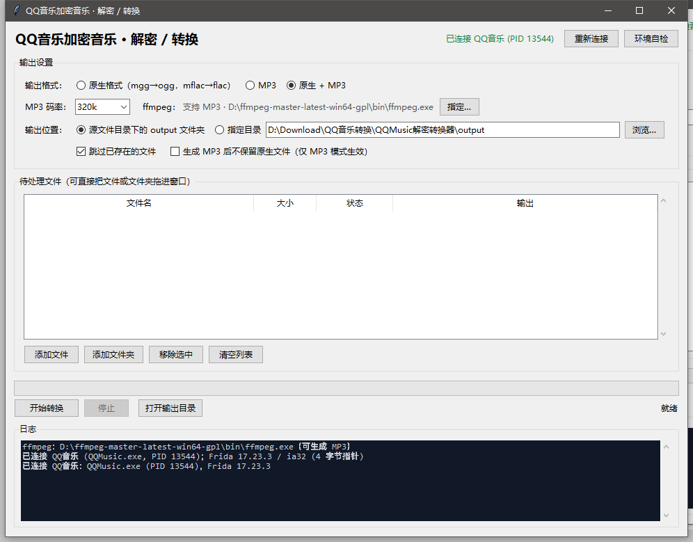

# QQ音乐 VIP歌曲解密 QQ MUSIC decrypt
* 自动搜索qq音乐下载目录下的文件
* mflac 自动转换为 flac 到当前目录的output
* mgg 自动转换为 ogg 到当前目录的output

免责声明
工具不提供VIP歌曲下载，仅用于个人已购买/已下载VIP音乐的格式转换与备份，请勿用于传播版权内容。

## 使用方法:
* 1 打开qq音乐
* 2 下载想要的音乐
* 3 到 [release](https://github.com/luyikk/qqmusic_decrypt/releases) 下载指定系统的程序
* 4 下载完成后解压到桌面 直接运行此程序,注意:运行期间不要关闭qq音乐
* 5 若没改过QQ音乐默认下载路径可以直接回车开始解析；若修改过或想解析其他目录则拖拽路径或歌曲到界面

---

## GUI 版本（Windows · 拖拽式）

`python-gui/` 是一个图形界面版本：把加密音乐**直接拖进窗口**即可自动解密，
并可以一键转成 MP3。



### 下载即用（推荐）

到 **Releases** 下载 **`qqmusic_gui.zip`**，解压后双击 `qqmusic_gui.exe` 即可。

免安装 —— 已内置 Python 运行时、frida、tkinterdnd2 和 ffmpeg，
**不需要装 Python，也不需要 pip install 任何东西**。
唯一前提：**先启动 QQ音乐并登录**。

* 输出格式：**原生**（`mgg→ogg`、`mflac→flac`）／**MP3**（128~320 kbps）／**原生 + MP3**
* 支持一次拖入多个文件或整个文件夹（递归查找）
* 支持「跳过已存在文件」，重复运行只处理新增的
* 内置环境自检

### 依赖

```bat
python -m pip install frida tkinterdnd2
```

转 MP3 另需 **ffmpeg**（要带 `libmp3lame`）：
放到 `python-gui/ffmpeg/bin/`，或加入 `PATH`，或在界面里点「指定…」选择。

### 运行

```bat
python python-gui/qqmusic_gui.py
```

或双击 `python-gui/启动工具.bat`。也可以直接下载 release 里的
`qqmusic-decrypt-gui-*.zip` 解压即用。

### 自检

```bat
python python-gui/selftest.py
```

会逐项检查依赖、ffmpeg、QQ音乐进程、Frida 注入与解密函数导出，
并用一个普通音频文件做逐字节比对，确认整条解密链路正确。

> ⚠️ 踩坑提醒：`EncAndDesMediaFile::Open` 的第二个参数若传 `(0, 1)`，
> QQ音乐会把**源文件截断为 0 字节**。GUI 版只使用经过验证的 `(1, 0)`。

详细说明见 [python-gui/README.md](python-gui/README.md)。

## 原理

不自己实现 QMC 算法，而是借用 QQ音乐自己的解密代码。

`QQMusicCommon.dll` 中的 `EncAndDesMediaFile` 本质是一个"会自动解密的 ifstream"：

```
构造对象 → Open(路径, true, false) → GetSize() 取得明文长度 → Read() 读出明文
```

用 Frida 注入 JS，在 QQ音乐进程内调用这几个导出函数即可，
任何新版本加密格式都能自动支持。详见 [python-gui/README.md](python-gui/README.md)。
